<a href="https://maheshchalla2701.github.io/MaheshChalla2701/">
  
</a>

  
  
  
  




<a href="https://play.google.com/store/apps/details?id=com.maheshchalla.fizi"></a>

  
  
  

<a href="https://play.google.com/store/apps/details?id=com.splitplan.splitplan"></a>

  
  

<a href="https://github.com/MaheshChalla2701/collaborative-ai"></a>

  

<a href="https://github.com/MaheshChalla2701/Safe-Street"></a>

  
  
  



  

<a href="https://maheshchalla2701.github.io/MaheshChalla2701/#highlights"></a>


  
  
  
  

<a href="https://maheshchalla2701.github.io/MaheshChalla2701/">
  
</a>
