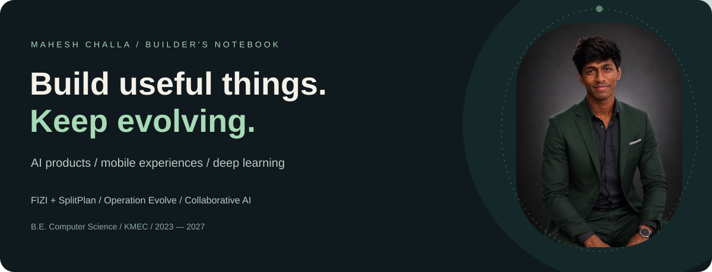
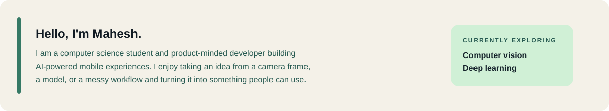
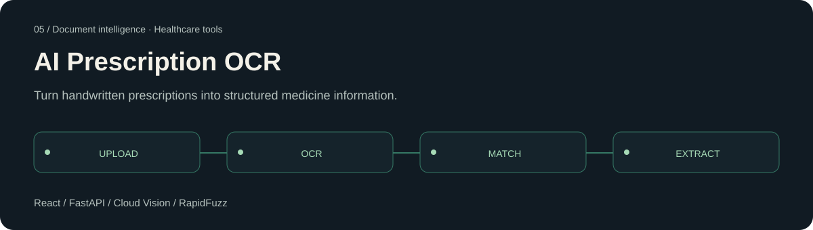
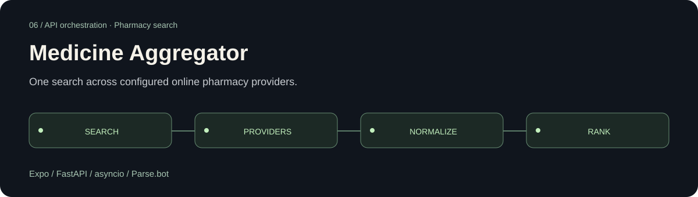
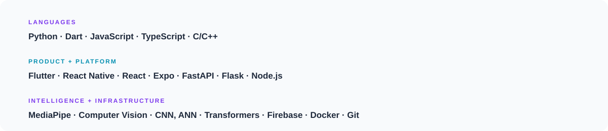

[Portfolio](https://maheshchalla2701.github.io/MaheshChalla2701/) · [LinkedIn](https://www.linkedin.com/in/mahesh-challa/) · [Email](mailto:mahesh.ch0127@gmail.com)

Combines hierarchical expert routing, replay buffers and Learning without Forgetting. Sequential training uses evaluation checkpoints and rollback to guard model updates.

[Repository ↗](https://github.com/MaheshChalla2701/Operation-Evolve)

Language models answer in parallel, rank anonymized responses and pass the results to a chairman model. Includes streamed responses, Firebase authentication, persistent conversations and memory.

[Repository ↗](https://github.com/MaheshChalla2701/collaborative-ai)

Python and MediaPipe analyze captured frames for end-of-set form scoring and rep counting. Workout planning, nutrition, progress analytics and an AI assistant connect the experience.

[Repository ↗](https://github.com/MaheshChalla2701/FIZI) · [Google Play ↗](https://play.google.com/store/apps/details?id=com.maheshchalla.fizi)

Real-time group expenses, flexible splits, receipt OCR, debt simplification and trip planning. UPI deep links open an existing payment app; SplitPlan records balances and settlements.

[Repository ↗](https://github.com/MaheshChalla2701/SplitPlan) · [Google Play ↗](https://play.google.com/store/apps/details?id=com.splitplan.splitplan)

Google Cloud Vision OCR, spatial line grouping and RapidFuzz matching extract medicine names, dosage, frequency and duration from images and PDFs.

[Repository ↗](https://github.com/MaheshChalla2701/prescription)

Parallel API requests, normalized responses and ranked availability in a single report. Provider failures are isolated; supported pharmacies depend on the configured integrations.

[Repository ↗](https://github.com/MaheshChalla2701/medicine-aggregator)

[Email](mailto:mahesh.ch0127@gmail.com) · [LinkedIn](https://www.linkedin.com/in/mahesh-challa/) · [GitHub](https://github.com/MaheshChalla2701)

