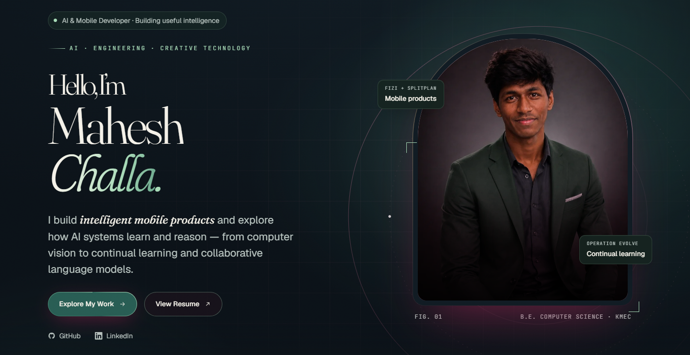
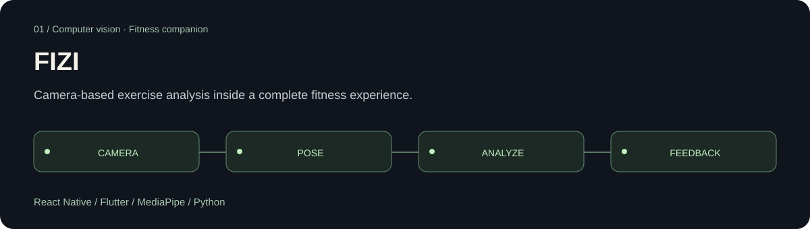
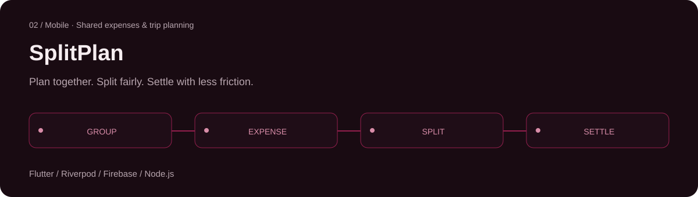
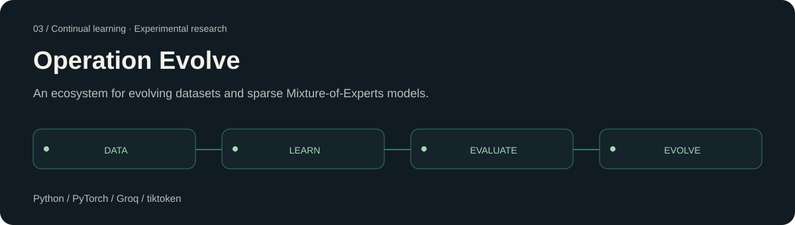
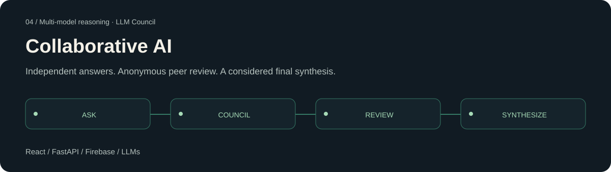

<!-- Generated from site/index.html by npm run readme. Edit the portfolio, then regenerate. -->

# Mahesh Challa

**AI & Mobile Developer · Building useful intelligence**

I build intelligent mobile products and explore how AI systems learn and reason — from computer vision to continual learning and collaborative language models.

[Portfolio](https://maheshchalla2701.github.io/MaheshChalla2701/) · [Resume](https://maheshchalla2701.github.io/MaheshChalla2701/resume.html) · [LinkedIn](https://www.linkedin.com/in/mahesh-challa/) · [Email](mailto:mahesh.ch0127@gmail.com)

[About](#about) · [Activity](#github-activity) · [Projects](#selected-projects) · [Skills](#skills) · [Milestones](#milestones) · [Journey](#journey) · [Contact](#contact)

## About

I’m Mahesh Challa, a Computer Science student at Keshav Memorial Engineering College, studying from 2023 to 2027.

I enjoy connecting intelligent systems with useful software. My work spans mobile apps, computer vision, language model orchestration and experimental continual learning.

FIZI and SplitPlan explore everyday needs. Operation Evolve and Collaborative AI explore how models can keep learning and reason together.

- **Understand the mechanism.** Study models and pipelines from the inside, including CNNs, Transformers and sparse expert routing.

- **Build the whole experience.** Connect mobile interfaces, backend services and persistent data into products people can use.

- **Make improvements measurable.** Use evaluation, feedback and checkpoints when exploring learning systems.

## GitHub activity

[View my GitHub activity](https://github.com/MaheshChalla2701?tab=overview)

## Selected projects

### FIZI

**Camera-based exercise analysis inside a complete fitness experience.**

Python and MediaPipe analyze captured frames for end-of-set form scoring and rep counting. Workout planning, nutrition, progress analytics and an AI assistant connect the experience.

**Built with:** React Native · Flutter · MediaPipe · Python

[Repository ↗](https://github.com/MaheshChalla2701/FIZI) · [Google Play ↗](https://play.google.com/store/apps/details?id=com.maheshchalla.fizi)

### SplitPlan

**Plan together. Split fairly. Settle with less friction.**

Real-time group expenses, flexible splits, receipt OCR, debt simplification and trip planning. UPI deep links open an existing payment app; SplitPlan records balances and settlements.

**Built with:** Flutter · Riverpod · Firebase · Node.js

[Repository ↗](https://github.com/MaheshChalla2701/SplitPlan) · [Google Play ↗](https://play.google.com/store/apps/details?id=com.splitplan.splitplan)

### Operation Evolve

**An ecosystem for evolving datasets and sparse Mixture-of-Experts models.**

Combines hierarchical expert routing, replay buffers and Learning without Forgetting. Sequential training uses evaluation checkpoints and rollback to guard model updates.

**Built with:** Python · PyTorch · Groq · tiktoken

[Repository ↗](https://github.com/MaheshChalla2701/Operation-Evolve)

### Collaborative AI

**Independent answers. Anonymous peer review. A considered final synthesis.**

Language models answer in parallel, rank anonymized responses and pass the results to a chairman model. Includes streamed responses, Firebase authentication, persistent conversations and memory.

**Built with:** React · FastAPI · Firebase · LLMs

[Repository ↗](https://github.com/MaheshChalla2701/collaborative-ai)

## Skills

### Languages

- **Python** — Training models, computer vision and FastAPI backends.

- **Dart** — Flutter mobile clients, including SplitPlan.

- **JavaScript / TypeScript** — React interfaces and Node.js services.

### AI & learning

- **PyTorch** — Experimental continual learning and sparse MoE architectures.

- **CNN, ANN / Transformers** — Neural network foundations and model architecture exploration.

- **MediaPipe** — Pose analysis in FIZI.

- **LLM councils** — Parallel answers, peer review and chairman synthesis.

### Product engineering

- **Flutter / React Native** — Mobile experiences across FIZI and SplitPlan.

- **React / Expo** — Web interfaces and mobile prototypes.

- **FastAPI / Firebase** — APIs, authentication and persistent app data.

- **Git / Docker** — Version control and reproducible environments.

## Milestones

- **FIZI & SplitPlan.** Fitness coaching and shared expenses, from interface to backend.

- **Continual learning.** Operation Evolve explores dataset changes, replay and sparse expert models.

- **Collaborative reasoning.** Anonymous peer review connects multiple LLM perspectives.

- **Four selected projects.** FIZI, SplitPlan, Operation Evolve and Collaborative AI.

## Journey

### B.E. Computer Science

**2023 — 2027 · Keshav Memorial Engineering College**

Studying software, algorithms and intelligent systems.

### FIZI & SplitPlan

**PRODUCT DEVELOPMENT · Mobile products**

Building app interfaces, backend integrations and complete user workflows.

### Operation Evolve & Collaborative AI

**RESEARCH EXPLORATION · Learning and reasoning systems**

Exploring continual model improvement and multi-model deliberation.

## Contact

Have a problem worth solving, or want to talk AI products and backend systems? My inbox is open.

[Email](mailto:mahesh.ch0127@gmail.com) · [LinkedIn](https://www.linkedin.com/in/mahesh-challa/) · [GitHub](https://github.com/MaheshChalla2701)

